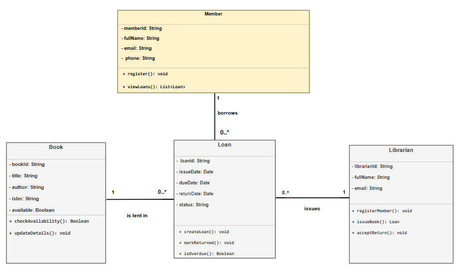

# Library Management System — UML Class Diagram Assignment

**Institution:** Kigali Independent University (ULK)
**Instructor:** Eric Maniraguha
**Group members:** 

| # | Name | Student ID |
|---|------|------------|
| 1 | Moaz Mohammed Yacoub | 202510648 |
| 2 | Amar Ahmed Alduom | 202512897 |

## Business Idea

A library needs an information system to organise its books, registered members, librarians, and the borrowing and returning of books.

## Project Scope

The system models:

- Book information (ID, title, author, ISBN, availability).
- Member registration and member details.
- Librarian information and librarian tasks.
- Loans: issue date, due date, return date, and status.

This project focuses on **designing the system with a UML class diagram**. It does not include a working application, user interface, database, online reservations, payments, or notifications.

## Main Classes

| Class | Responsibility |
|-------|----------------|
| **Book** | Stores book details and shows whether a book is available. |
| **Member** | Stores details of a registered library user and lets them view their loans. |
| **Librarian** | Registers members, issues books, and accepts returned books. |
| **Loan** | Records one borrowing transaction and its dates and status. |

## Relationships

| Relationship | Multiplicity | Meaning |
|--------------|--------------|---------|
| Member — Loan | 1 to 0..* | One member can have many loans; each loan belongs to one member. |
| Book — Loan | 1 to 0..* | One book can be lent many times over time; each loan is for one book. |
| Librarian — Loan | 1 to 0..* | One librarian can issue many loans; each loan is issued by one librarian. |

## UML Class Diagram



## Repository Structure

```
.
├── README.md
├── documentation/
│   ├── report_1_project_description.md
│   ├── report_1_project_description.pdf
│   ├── report_2_uml_class_diagram.md
│   └── report_2_uml_class_diagram.pdf
└── diagrams/
    ├── uml_class_diagram.drawio
    └── uml_class_diagram.png
```

## Reports

- [Report 1 — Project Description](documentation/report_1_project_description.md)
- [Report 2 — UML Class Diagram](documentation/report_2_uml_class_diagram.md)
